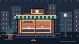
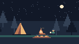
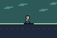

# Animated Pixel Art Studio

**An AI agent skill that turns a creative brief into editable pixel animation and real video files.**

[Bahasa Indonesia](README.id.md) · [Agent skill](skills/animated-pixel-art-studio/SKILL.md) · [Scene format](skills/animated-pixel-art-studio/references/scene-format.md) · [MIT license](LICENSE)


Describe the scene to an agent, let it author sprites and motion, and render locally. The repository supplies the production workflow, a small deterministic renderer, and original starter scenes. It does **not** contain a trained text-to-video model or a graphical editor.

## What you get

- A portable `SKILL.md` with art direction, scene planning, animation, export, and visual QA instructions.
- Editable JSON scenes, palette-based sprite cels, imported native PNGs, layers, visibility ranges, and position tracks.
- PNG frame sequences, animated GIFs, MP4 video, a poster, contact sheet, and machine-readable render report.
- Three original demo scenes: rainy cafe, campfire, and a simple walk cycle, plus a blank starter.
- No API key, GPU, paid model, or network access needed for rendering after dependencies are installed.
- Automated tests and GitHub Actions configuration for Windows, macOS, Linux, and video encoding.

## Try it in a few commands

Install **Python 3.10+** and Git, then clone:

```sh
git clone https://github.com/hrusyd/animated-pixel-art-studio.git
cd animated-pixel-art-studio
python -m venv .venv
```

Activate the environment:

| Platform | Command |
| --- | --- |
| Windows PowerShell | `.venv\Scripts\Activate.ps1` |
| Windows cmd | `.venv\Scripts\activate.bat` |
| macOS / Linux | `source .venv/bin/activate` |

If activation is restricted, invoke the environment's Python directly, e.g. `.venv\Scripts\python.exe studio.py doctor`. On systems where Python is named `python3`, use that to create the environment.

```sh
python -m pip install -r requirements.txt
python studio.py doctor
python studio.py init --preset rainy-cafe --out work/my-scene.json
python studio.py render work/my-scene.json --out output/my-first-loop --formats png,gif
```

Open `output/my-first-loop/animation.gif`. Edit `work/my-scene.json` and render again to a **new** output folder. Existing output files are never overwritten.

For MP4, install [FFmpeg](https://ffmpeg.org/download.html), ensure `ffmpeg` is on PATH, then run:

```sh
python studio.py render work/my-scene.json --out output/my-first-video --formats png,gif,mp4
```

Use `--ffmpeg "path/to/ffmpeg"` if it is not on PATH. FFmpeg must include the `libx264` encoder. If it is absent, GIF/PNG still work; requesting MP4 fails explicitly.

## Use it with an AI agent

Give a coding agent with filesystem and shell access this instruction:

> Read `skills/animated-pixel-art-studio/SKILL.md` and use it to create a 4-second looping pixel art scene of a tiny ramen shop in the rain. Use warm windows, a blinking cat, a fixed palette, and crisp pixels. Deliver a GIF, MP4, and editable source. Inspect the contact sheet and report actual checks.

For a host that supports installable skills, copy the **entire** skill folder to its documented skills directory. The exact directory and activation mechanism depend on the host:

```sh
python tools/install_skill.py --target /path/to/your/agents/skills
```

The installer refuses overwrites and does not change agent settings. The copied folder contains everything the skill needs, including its renderer and presets. Python/Pillow and optional FFmpeg are still required. A chat-only agent without file execution can discuss the workflow but cannot run this renderer.

Invoke `$animated-pixel-art-studio` where your agent supports that syntax, or explicitly ask it to read the installed `SKILL.md`. No particular provider integration is required or claimed.

## Example prompts

| Goal | Prompt |
| --- | --- |
| Ambient loop | Create a 4-second pixel art campfire loop, with a traveler, breathing fire shapes, and subtle sparks. |
| Character motion | Design an original 16x16 robot and animate four walking poses with consistent ground contact. |
| Vertical video | Create a 6-second 9:16 pixel art scene of a floating garden at night, native 90x160, GIF and MP4. |
| Your own sprites | Use my native PNG cels, keep their exact palette, and assemble a 12 fps animation with a contact sheet. |
| Longer story | Plan a 12-second pixel art story in three shots, render each, then assemble and verify the final video. |

The agent must actually customize scenes for a new brief. Presets are starting points, not a substitute for original art direction.

## Gallery

| Rainy cafe | Campfire | Walk cycle |
| --- | --- | --- |
|  |  |  |
| [MP4](docs/gallery/rainy-cafe.mp4) | [MP4](docs/gallery/campfire.mp4) | [MP4](docs/gallery/walk-cycle.mp4) |

These are small, code-authored starter animations included under MIT. The cafe/campfire are 160x90 native pixels; the character study is 96x64. All examples run for four seconds at 12 fps. GIF previews use native dimensions; MP4 and PNG use integer enlargement.

### Made by an agent using the skill


An independent agent used this skill with a new brief to create **Little Beacon**, an original 2-second floating robot loop. [MP4](docs/gallery/robot.mp4) · [Editable scene](examples/robot/scene.json) · [Brief](examples/robot/brief.md). This demonstrates one successful trial, not a guarantee of quality across every agent or prompt.

```sh
python studio.py render examples/robot/scene.json --out output/robot --formats png,gif,mp4
```

## How it works

1. The agent writes a brief and designs a fixed palette, sprites, layers, and timing.
2. The validator catches invalid palettes, missing cels, unsupported fields, and unsafe asset paths.
3. The renderer composites at native resolution and enlarges using nearest-neighbor.
4. Exports include editable sources and QA evidence for inspection and iteration.

Read the [scene specification](skills/animated-pixel-art-studio/references/scene-format.md) for a minimal complete example. Read [art direction](skills/animated-pixel-art-studio/references/art-direction.md) for consistency and loop design. The [integration notes](skills/animated-pixel-art-studio/references/integrations.md) explain optional editors, image tools, and multi-shot assembly.

## Scope and limits

- This is an initial toolkit, not an automatic professional animation model. Art quality depends on the agent's authored assets and visual iteration.
- GIFs use native size and centisecond timing. PNG frames are lossless masters; MP4 color edges may change through H.264/yuv420p compression.
- MP4 output is silent. Audio, subtitles, sprite-sheet slicing, multi-shot assembly, generative models, ComfyUI, and Aseprite integrations are separate workflows, not built-in features.
- A looping GIF flag does not prove a seamless loop. The report contains diagnostics, and the skill requires visual inspection.
- Resource limits: canvas <=512x512, <=600 frames, <=40 million native frame pixels, <=64 palette colors. Split larger work into shots.
- Imported sprites must be native PNGs with binary alpha and exact palette colors. Use only assets you have permission to distribute.

## Development

```sh
python -m unittest discover -s tests -v
python tools/build_examples.py
```

FFmpeg/ffprobe enable the video metadata integration test; it is skipped if they are unavailable. CI includes a Linux job that installs FFmpeg. CI results are visible in the repository Actions tab; local test results do not imply every remote matrix job has run.

Keep the skill self-contained and test it outside the repository. See [CONTRIBUTING.md](CONTRIBUTING.md). Code, documentation, and included original sample art are MIT licensed. Third-party dependencies retain their own licenses.
